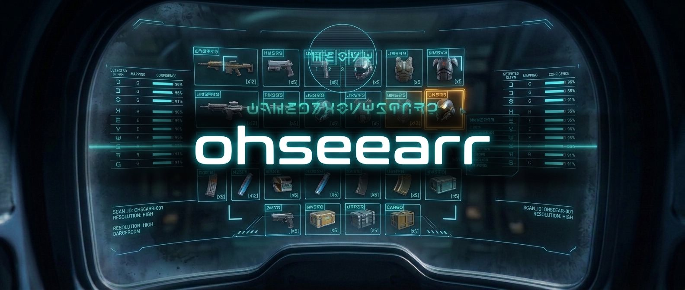
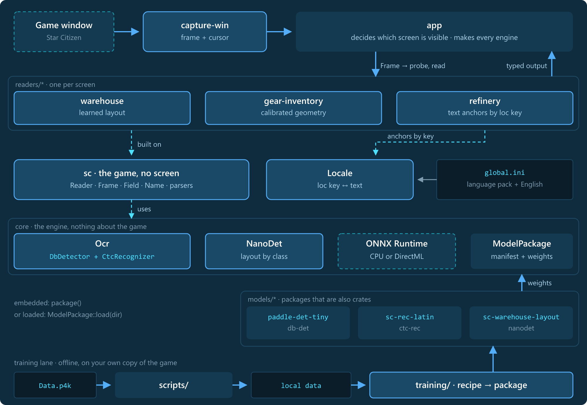

<p align="center"></p>

<h1 align="center">sc-ohseearr</h1>

<p align="center">
  <a href="https://github.com/w00zla/sc-ohseearr/actions/workflows/test.yml"></a>
  <a href="https://github.com/w00zla/sc-ohseearr/releases"></a>
  <a href="LICENSE"></a>
  <a href="Cargo.toml"></a>
  
</p>

<p align="center">
  OCR-framework for Star Citizen: read what the game shows, from a frame of its window, as typed values. An engine on
  ONNX Runtime, models tuned to the game's UI, ready readers for real screens and the pipelines that train the
  models. It started as the OCR core of the Quartermaster companion app.
</p>

- **Engine:** PP-OCRv6 tiny detection and recognition on ONNX Runtime, on the CPU or the GPU (DirectML), batched.
- **Models for the game:** a recognizer fine-tuned on the game's UI font, a layout detector trained on a screen.
- **Readers:** the freight manager's warehouse, the character inventory, the refinery terminal and the mining HUD's
  signature, each one call per frame with neutral, typed output.
- **The game's language:** texts come from the player's `global.ini` by loc key, so readers work with language packs.
- **Capture:** a live grab of the game window, with the cursor, its rest and a change gate: on Windows by the
  executable (DXGI), on Linux through the ScreenCast portal and PipeWire (the user picks the window once).
- **Training included:** one recipe per model turns local data into a model package; a new screen is a recipe and
  data, no engine code.

> **Status:** early, APIs change until 1.0. The Linux window capture is verified on KDE Plasma (Wayland) only.

## Requirements

- Rust 1.88+ (edition 2024, let chains) and git.
- Windows 10/11 or Linux. Building on Linux needs libpipewire's headers (`libpipewire-0.3-dev`, `pipewire-devel`)
  and clang, for the window capture; that capture needs a desktop with the ScreenCast portal (xdg-desktop-portal).
- GPU acceleration under Windows needs Microsoft's redistributable `DirectML.dll` 1.15
  next to the executable.
- For readers that anchor on the game's texts (i.e. the refinery): the `global.ini` of your game and/or a translated ini-file (see
  [The game's texts](#the-games-texts)).
- For training: an NVIDIA GPU, Python 3.11 with [uv](https://docs.astral.sh/uv/) and your own copy of the game's `Data.p4k` file (see [training/README.md](training/README.md)).

## Use

A git dependency (no crates.io), pinned by a release tag or a revision. Every crate of the repository:

```toml
[dependencies]
# The engine and the models
sc-ohseearr-core = { git = "https://github.com/w00zla/sc-ohseearr", tag = "v0.2.0" }  # features = ["directml"] for the GPU
sc-ohseearr-model-paddle-det-tiny = { git = "https://github.com/w00zla/sc-ohseearr", tag = "v0.2.0" }
sc-ohseearr-model-sc-rec-latin = { git = "https://github.com/w00zla/sc-ohseearr", tag = "v0.2.0" }
sc-ohseearr-model-sc-warehouse-layout = { git = "https://github.com/w00zla/sc-ohseearr", tag = "v0.2.0" }
# The game: texts, parsers, the reader interface; the readers
sc-ohseearr-sc = { git = "https://github.com/w00zla/sc-ohseearr", tag = "v0.2.0" }
sc-ohseearr-warehouse = { git = "https://github.com/w00zla/sc-ohseearr", tag = "v0.2.0" }
sc-ohseearr-gear-inventory = { git = "https://github.com/w00zla/sc-ohseearr", tag = "v0.2.0" }
sc-ohseearr-refinery = { git = "https://github.com/w00zla/sc-ohseearr", tag = "v0.2.0" }
sc-ohseearr-mining-hud = { git = "https://github.com/w00zla/sc-ohseearr", tag = "v0.2.0" }
# The window capture (Windows)
sc-ohseearr-capture-win = { git = "https://github.com/w00zla/sc-ohseearr", tag = "v0.2.0" }
```

The engine alone, the text lines of an image:

```rust
use std::path::Path;
use sc_ohseearr_core::{ModelPackage, Ocr};

let det = sc_ohseearr_model_paddle_det_tiny::package();      // compiled in
let rec = ModelPackage::load(Path::new("models/sc-rec-latin"))?; // or a package folder loaded at run time
let mut ocr = Ocr::new(&det, &rec, 3, false)?;                 // 3 threads, CPU (true: GPU)
for line in ocr.read(&image, 800)? {                           // the frame scaled to 800 px height
    println!("{} ({:.2})", line.text, line.score);
}
```

A model on its own, the warehouse layout detector:

```rust
let mut layout = sc_ohseearr_core::NanoDet::new(&sc_ohseearr_model_sc_warehouse_layout::package(), 3, false)?;
for d in layout.detect(&image)? {                              // the classes of `layout.classes()`
    println!("{:?}", d);
}
```

Everything together, the game window read live by all readers:

```rust
use std::path::Path;
use sc_ohseearr_capture_win::{WindowCapture, set_per_monitor_dpi_aware};
use sc_ohseearr_core::{NanoDet, Ocr};
use sc_ohseearr_gear_inventory::GearInventoryReader;
use sc_ohseearr_refinery::RefineryReader;
use sc_ohseearr_sc::{Frame, LocTable, Locale, Reader};
use sc_ohseearr_warehouse::WarehouseReader;

// The models, all on the same threads and device: the OCR (detector, recognizer) and the warehouse layout detector
let (threads, gpu) = (3, false);
let mut ocr = Ocr::new(&sc_ohseearr_model_paddle_det_tiny::package(), &sc_ohseearr_model_sc_rec_latin::package(), threads, gpu)?;
let layout = NanoDet::new(&sc_ohseearr_model_sc_warehouse_layout::package(), threads, gpu)?;
// The game's texts: the player's language pack (if any) first, then the English table
let locale = Locale::new(None, Some(LocTable::load(Path::new("global-english.ini"))?))?;
// The readers; each keeps its own state across frames (the warehouse reader its last layout)
let mut warehouse = WarehouseReader::new(layout)?;
let (mut gear, mut refinery) = (GearInventoryReader::new(), RefineryReader::new());

set_per_monitor_dpi_aware()?;                                  // once, before any window exists
let mut capture = WindowCapture::new("StarCitizen.exe");
let mut id = 0;
loop {
    // A frame of the game window while it is in front, with the cursor; None: no new image
    let Some(shot) = capture.grab()? else { continue };
    let image = shot.pixels.into_rgb();
    id += 1;
    let frame = Frame { id, image: &image, cursor: shot.cursor, locale: Some(&locale) };
    // Which screen is visible is the app's business: probe (cheap), then read
    if warehouse.probe(&mut ocr, &frame)? {
        let w = warehouse.read(&mut ocr, &frame)?.output;      // tiles, the hovered tile's tooltip
    } else if gear.probe(&mut ocr, &frame)? {
        let g = gear.read(&mut ocr, &frame)?.output;           // page, hovered cell, tooltip with stats
    } else if refinery.probe(&mut ocr, &frame)? {
        let r = refinery.read(&mut ocr, &frame)?.output;       // station, work orders with their rows
    }
}
```

- `ort` is pinned to `=2.0.0-rc.13`: a build has one ONNX Runtime, so a consumer uses that version too.
- Frames go in at their native size; the readers scale them by their height (the game's UI scales with it, on 16:9
  as on ultrawide).
- Diagnostics (every text box read, fit internals) come with `set_diagnostics(true)`, as `read(..)?.diagnostics`.

## How it works

<p align="center"><a href="docs/assets/arch-overview.png"></a></p>

The details, from a frame through a read to the training of a model: [docs/ARCHITECTURE.md](docs/ARCHITECTURE.md).

A new screen is a new folder in `readers/` (and maybe in `models/`), not a change to `core` or `sc`.

### Model families

| Family | Type | What it does |
|---|---|---|
| `db-det` | `DbDetector` | finds text lines (PaddleOCR detector, DB post-processing) |
| `ctc-rec` | `CtcRecognizer` | reads one text line (PaddleOCR recognizer, CTC decoding) |
| `nanodet` | `NanoDet` | finds a screen's parts by class (a layout model trained per screen) |

`Ocr` pairs a detector and a recognizer.

### Model packages

Each folder in `models/` is a package and a crate: `model.onnx`, its manifest `model.toml` (family, input
normalization, thresholds, classes or dictionary, license, source), `MODEL.md` (purpose, making, measurements) and a
crate whose `package()` returns it compiled in. `ModelPackage::load(dir)` loads the same folder at run time, so a model
can be swapped without code changes.

| Package | Family | License | |
|---|---|---|---|
| [`paddle-det-tiny`](models/paddle-det-tiny/MODEL.md) | `db-det` | Apache-2.0 | PP-OCRv6 tiny detector, unmodified |
| [`sc-rec-latin`](models/sc-rec-latin/MODEL.md) | `ctc-rec` | Apache-2.0 | PP-OCRv6 tiny recognizer cut to Latin, fine-tuned on the game's font |
| [`sc-warehouse-layout`](models/sc-warehouse-layout/MODEL.md) | `nanodet` | MIT | the freight manager's warehouse grid and tooltip |

### Readers

| Reader | Reads | Pattern |
|---|---|---|
| [`warehouse`](readers/warehouse/README.md) | the freight manager's warehouse: grid, hovered tile, tooltip | a learned layout model, then targeted reads |
| [`gear-inventory`](readers/gear-inventory/README.md) | the character inventory: the hovered item's tooltip, page, tile | calibrated geometry around the frame's centre |
| [`refinery`](readers/refinery/README.md) | the refinery terminal's work orders | text anchors by loc key |
| [`mining-hud`](readers/mining-hud/README.md) | the signature of a ship's scan | a window around the HUD's centre, the number by its form |

Each implements `sc::Reader`: `probe` (is my screen in view, cheap), `read`, `reset`, `set_diagnostics`, on a
`Frame { id, image, cursor, locale }`. A reader keeps its own state across frames. The output is neutral, what the
game shows: uncertain values as `Field` (value, raw text, score, ambiguous), names as `Name` with candidate loc keys;
diagnostics (all text boxes, fit internals) come separately. Which screen is visible and how often to read is the
app's business.

### The game's texts

Readers carry no game text. They anchor on loc keys and take the texts from the frame's `Locale`: game's English table and optionally the player's language pack (`data/Localization/<language>/global.ini`). The
English table lives inside `Data.p4k` as `Data/Localization/english/global.ini`; any tool that extracts files from
`Data.p4k` gets it (there are several). `scripts/extract-global-ini.{ps1,sh}` does it with StarBreaker and names the
file by the game build:

```powershell
scripts/extract-global-ini.ps1 -StarBreaker <starbreaker.exe> -P4k <install>/LIVE/Data.p4k -Out <dir>   # Linux: scripts/extract-global-ini.sh
```

## Develop

```sh
git clone --recurse-submodules https://github.com/w00zla/sc-ohseearr   # with the readers' test frames (fixtures/)
git submodule update --init                       # in an existing clone
cargo test --release --workspace
cargo clippy --release --workspace --all-targets
cargo fmt --all
cargo run --release --example ocr_dump -- <image> [max_height] [threads] [--det <dir>] [--rec <dir>] [--gpu]
cargo run --release --example layout_dump -- <image> [x y w h]
cargo run --release -p sc-ohseearr-refinery --example regress-refinery -- --english <global.ini>   # likewise regress-warehouse, regress-gear-inventory; regress-mining-hud needs no ini
```

- `examples/tests/models.rs` runs every model package on a synthetic image and checks its outputs against the
  manifest (no data needed).
- The readers' tests read single frames of debug recordings from the submodule `fixtures/` (the repository
  [sc-ohseearr-fixtures](https://github.com/w00zla/sc-ohseearr-fixtures)) and fail when it is not checked out.
- Each reader's `regress` example prints its output per frame over its regression set: compare the lines before and
  after a change. Results must not change silently.
- Training: [`training/README.md`](training/README.md) (setup, the fonts and language files you provide, recipes).
- Changes land on `main` through pull requests; every pull request runs formatting, the tests and clippy on Linux
  and Windows, and shellcheck. New test frames go to
  [sc-ohseearr-fixtures](https://github.com/w00zla/sc-ohseearr-fixtures) (its README says how).

**Data root.** Local data stays out of git: `$SC_OHSEEARR_DATA`, else `local/` in the checkout (gitignored). The
`regress` examples (`--data <root>`) and the training pipelines (`--data-root <dir>`) read from it:

| Folder | What |
|---|---|
| `regression/<reader>/<set>/` | the regression sets: debug recordings the readers' `regression.toml` list |
| `sources/<set>/` | the training sources: recordings and screenshots the recipes and `training/tools/` read |
| `training/<id>/` | training runs |
| `screenshots/`, `stock_scan_debug/` | scratch for analysis and prototyping, never a regression set, a training source or a test frame |

## Game data and fan content

The repository holds game data only as small excerpts a test concretely needs (a few loc keys, each with its source
noted), never whole game files, fonts or recordings; the readers' test frames live in the separate repository
sc-ohseearr-fixtures. The readers take the game's texts
from your own installation; training uses data from your own copy of the game.

sc-ohseearr is an unofficial Star Citizen fan project, not endorsed by or affiliated with the Cloud Imperium group of
companies. Game content and materials are copyright Cloud Imperium Rights LLC and Cloud Imperium Rights Ltd. Star
Citizen® is a registered trademark of Cloud Imperium Rights LLC.

## Credits

[PaddleOCR](https://github.com/PaddlePaddle/PaddleOCR) (PP-OCRv6 detector and recognizer),
[NanoDet](https://github.com/RangiLyu/nanodet) (NanoDet-Plus), [ONNX Runtime](https://onnxruntime.ai/) through
[`ort`](https://github.com/pykeio/ort), [StarBreaker](https://github.com/diogotr7/StarBreaker) for reading `Data.p4k`,
[fontTools](https://github.com/fonttools/fonttools) for converting the game's fonts.

## License

Code: MIT, see [LICENSE](LICENSE). Each model package states its own license; see [NOTICE](NOTICE).
