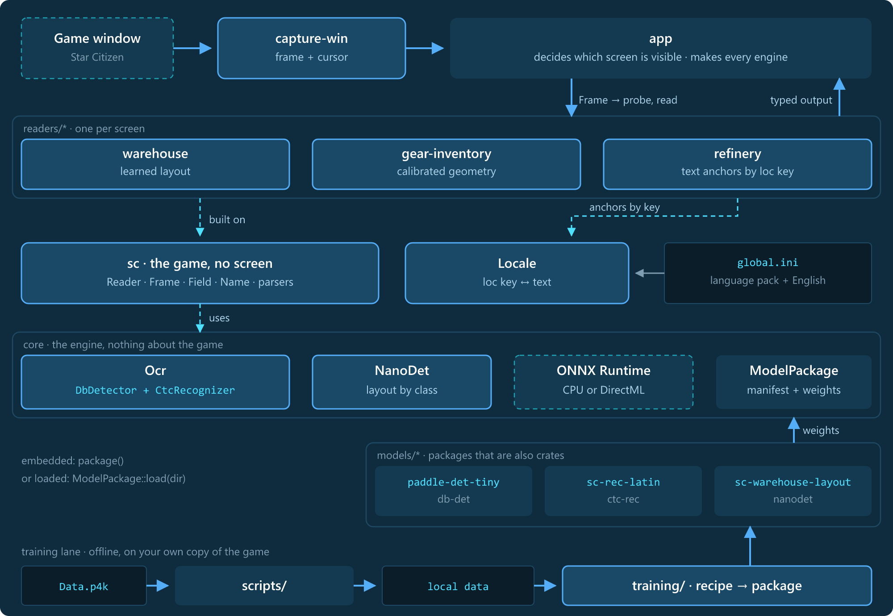

# Architecture

How sc-ohseearr is built: the layers and their dependency rule, a frame through a read, model packages, the readers,
the game's texts, training, and the tests. The decisions behind it are in [adr/](adr/README.md).

## Layers

The code is a stack; a layer knows only the ones below it.

- **core** knows nothing of the game: ONNX Runtime sessions, model families, packages, text boxes and lines.
- **sc** knows the game but no single screen: texts by loc key, the UI's scaling, value parsers and the `Reader`
  interface.
- **readers** know one screen each and build on `sc` and `core`.
- **models** are packages of weights and a manifest; each is also a crate that carries its package compiled in.
- **capture** holds what a capture loop needs on any platform (the captured pixels, the change gate, the cursor's
  rest); **capture-win** and **capture-linux** grab the game window on their platform. The three depend on nothing
  of the rest.
- **the app** (a consumer outside this repository) sits on top: it captures, decides which screen is visible, makes
  every engine and passes it in.

A new screen is a new folder in `readers/` (and maybe one in `models/`), not a change to `core` or `sc`.

| Layer | Path | Role |
|---|---|---|
| core | [`crates/core`](../crates/core) | `Ocr` (a `DbDetector` and a `CtcRecognizer`), `NanoDet`, `ModelPackage`, `group_lines`, image helpers; ONNX Runtime on the CPU or DirectML |
| sc | [`crates/sc`](../crates/sc) | `Locale` and `LocTable`, `CenterUi`, the parsers (qualities, SCU, counts, durations), the `Reader` trait with `Frame`, `Field`, `Name`, `Reading` |
| capture | [`crates/capture`](../crates/capture) | `Pixels`, the change gate `Gate`, the cursor-rest detector `Rest` |
| capture-win | [`crates/capture-win`](../crates/capture-win) | `WindowCapture` (DXGI): the window found by its executable, frame with cursor |
| capture-linux | [`crates/capture-linux`](../crates/capture-linux) | `WindowCapture` (ScreenCast portal, PipeWire): the window the user picked, frame with cursor, a frame with the cursor at rest |
| models | [`models/`](../models) | `paddle-det-tiny`, `sc-rec-latin`, `sc-warehouse-layout`: weights, `model.toml`, `MODEL.md`, a crate each |
| readers | [`readers/`](../readers) | `warehouse`, `gear-inventory`, `refinery`: a crate, a card (`README.md`) and a `regression.toml` each |
| test-support | [`crates/test-support`](../crates/test-support) | what tests and `regress` examples share: data root, arguments, regression folders, the compiled-in `Ocr` (not published) |
| training | [`training/`](../training) | Python pipelines and recipes that make model packages |
| scripts | [`scripts/`](../scripts) | `extract-global-ini` and `extract-fonts` (`.ps1` and `.sh`) over StarBreaker |

## A frame through a read

The app hands every reader the same input and gets neutral, typed output back.

| Step | What happens |
|---|---|
| Capture | `capture-win` or `capture-linux` returns the window's pixels and the mouse cursor; no new image while nothing changed (on Windows also while the window is not in front) |
| Frame | the app wraps them: `Frame { id, image, cursor, locale }` (native size; readers scale by the frame's height, the UI scales with it) |
| Probe | `probe(ocr, frame)` answers "is my screen in view?" cheaply; work it did is kept for `read` of the same `Frame::id` |
| Read | `read(ocr, frame)` returns `Reading { output, diagnostics }`; a reader keeps its own state across frames (`reset` drops it) |
| Output | what the game shows, typed: an uncertain value is a `Field` (value, raw text, score, ambiguous), a name a `Name` (text and candidate loc keys) |
| Diagnostics | every text box read and the fit's internals, separate from the output and only filled after `set_diagnostics(true)` |

Which screen is visible, in which order to probe and how often to read are the app's business; the readers do not
know each other. Errors are `ReadError`: the OCR failed, or the reader needs the game's texts and has none.

## Model packages and families

A package is a folder: `model.onnx`, `model.toml`, `MODEL.md` (purpose, making, measurements) and for recognizers a
`dict.txt`. The manifest is the contract between the weights and the code that runs them: the family, the input
normalization and size, thresholds, classes or the dictionary, license and source.

| Family | Type | What it does |
|---|---|---|
| `db-det` | `DbDetector` | finds text lines (PaddleOCR detector, DB post-processing) |
| `ctc-rec` | `CtcRecognizer` | reads one text line (PaddleOCR recognizer, CTC decoding) |
| `nanodet` | `NanoDet` | finds a screen's parts by class (a layout model trained per screen) |

`Ocr` pairs a detector and a recognizer on the same threads and device. A package is **embedded** (the model crate's
`package()` returns it compiled in) or **loaded** (`ModelPackage::load(dir)`); the same folder serves both, so a
model can be swapped without code changes.

The app makes every engine (`Ocr`, `NanoDet`) and passes it to the reader that needs it. A reader never builds a
model itself and never rebuilds one lazily; which package, which threads and which device are decided in one place.

## Readers

Each reader implements `sc::Reader` and is described in its own card (`readers/<name>/README.md`: screen, what it
reads, output types, resolutions, timings). They follow three patterns:

| Reader | Pattern | How |
|---|---|---|
| [`warehouse`](../readers/warehouse/README.md) | learned layout | the `sc-warehouse-layout` detector finds badges, quality texts and tooltip lines; the grid is fitted to them; only what is needed is recognized, and a strong fit is kept as the prior for the next frames |
| [`gear-inventory`](../readers/gear-inventory/README.md) | calibrated geometry | positions measured as shares of the frame's height around the centre (`CenterUi`), scaled by a factor calibrated from the page number's place; OCR only on the few areas that hold text |
| [`refinery`](../readers/refinery/README.md) | text anchors | table head, panel headers and column heads are found by their texts (by loc key); columns come from the head's words, rows from the material names below |

The pattern follows the screen. A fixed panel gets geometry, a screen that moves in the world gets a learned layout,
a screen made of labelled tables gets anchors. All three read through the same `Ocr`.

## The game's texts

Readers carry no game text. They name their anchors by loc key and take the texts from the frame's `Locale`:

- the player's **language pack** (`data/Localization/<language>/global.ini`, the language picked by `user.cfg`), if any,
- then the game's **English table**, which lives inside `Data.p4k` and is extracted with `scripts/extract-global-ini`.

`Locale::texts(key)` yields the texts of a key in that order; `Locale::keys_for(text)` goes the other way and gives
`Name` its candidate loc keys. A reader that needs the texts and has none fails with an explicit error
(`NoLanguageTable`), it does not guess. Which tables an app loads, and how it gets the English one, is the app's
decision. `LocTable::load` reads a file; `LocaleSource` rebuilds a `Locale` when the game's files change.

## Training

Training is offline and local. One **recipe** (a YAML file per model, in `training/recipes/`) plus local data becomes a
model package in the shape of `models/`: `model.onnx`, `model.toml`, a metrics block for `MODEL.md`.

| Pipeline | Family | Steps |
|---|---|---|
| `training/rec` | `ctc-rec` | cut the pretrained recognizer's head to a charset, render synthetic lines in the game's font, fine-tune, export, evaluate, package |
| `training/layout` | `nanodet` | config from the recipe, train NanoDet-Plus-m on a COCO dataset, export, evaluate per class, package |

- **Data root:** `$SC_OHSEEARR_DATA`, else `local/` (gitignored). Training sources, regression sets, runs and scratch
  have their own folders there; the recipes and tools read from it (`--data-root`).
- **The player's own data:** fonts, screenshots, recordings and language files are whole files of the game and never
  go into git. `scripts/extract-fonts` takes the UI fonts from `Data.p4k`, `scripts/extract-global-ini` the English
  texts; translations are fetched by the user.
- **Result:** `<out>/package/` is copied into `models/<id>/` after the metrics and the consumer's regression dumps were
  checked.

## Tests and regression

| Level | Where | What |
|---|---|---|
| Unit tests | next to the code in every crate | parsers, locale, geometry, line grouping, manifests |
| Model tests | `examples/tests/models.rs` | every model package runs on a synthetic image, its outputs are checked against its manifest; no data needed |
| Reader tests | in each reader, on the `fixtures/` submodule | single frames of debug recordings (repository `sc-ohseearr-fixtures`); they fail when the submodule is not checked out |
| Regress examples | `readers/*/examples/regress.rs` | a reader's output per frame over its regression set (the folders in `regression.toml`, under the data root); compare the printed lines before and after a change |

Results must not change silently: a change to the engine, a model or a reader keeps the consumer's regression dumps
identical, or the difference is shown and accepted. The regression sets are local; CI runs what is public: format,
`cargo test` and clippy (warnings denied) on Linux and Windows, `shellcheck` on the scripts.
